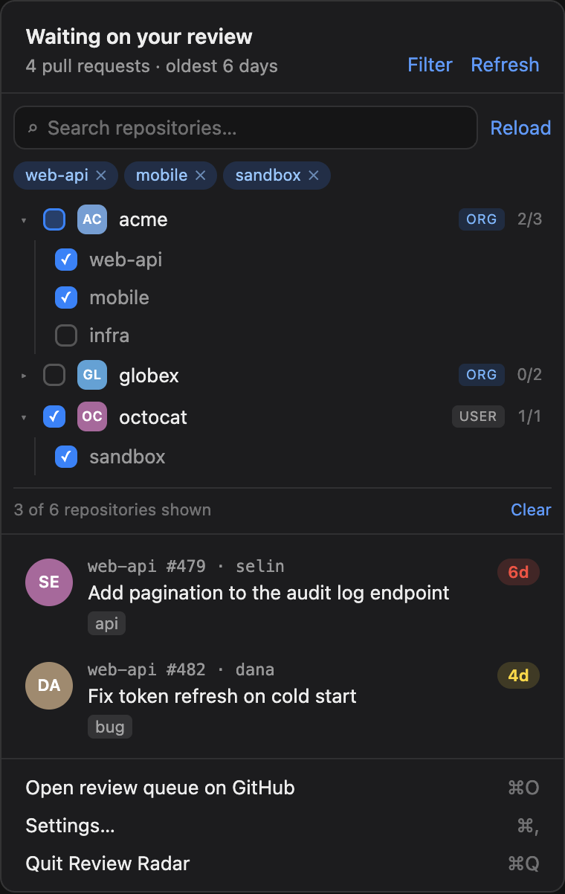
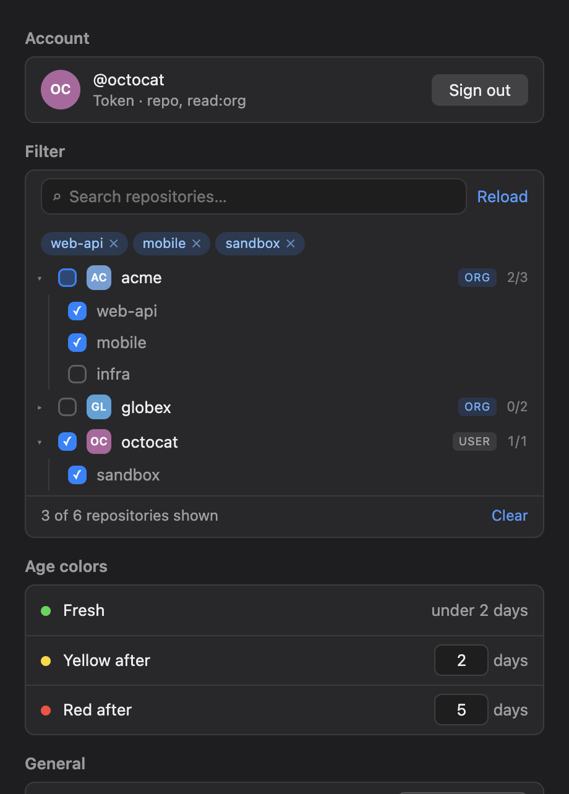

# Review Radar

A macOS menu bar app that shows the GitHub pull requests waiting on your review, how long each one has waited, and tells you when a new request comes in.

<p align="center">
  
</p>

Built with Electron. No runtime dependencies.

## What it does

- **Oldest first.** The panel lists every open pull request that asks for your review, with repo, author, labels and a colored age pill. Click a row to open it on GitHub.
- **Only what you work on.** Limit the app to the repositories you choose, grouped by owner — organizations and user accounts — from the panel or Settings. Pick a whole owner at once or individual repositories. An empty selection shows everything, and the menu bar count and notifications follow the same filter.
- **Ages that mean something.** The age counts from the latest review request sent to you or one of your teams, not from when the pull request was opened. If there is no such request, it falls back to the opening time.
- **Color as a nudge.** Pills turn yellow after 2 days and red after 5. You can change both in Settings.
- **A menu bar icon you can read at a glance.** It shows the count, takes the color of the oldest request, and turns blue with a `+N` badge when something new arrives.
- **Notifications.** One banner per new review request, and a 9:00 summary when something is past the red threshold. You can also turn on a short chime for new requests in Settings and preview it there.
- **Keyboard friendly.** `⌘R` refreshes, `⌘O` opens your review queue on GitHub, `⌘,` opens Settings, `Esc` closes the panel.

### Menu bar icon


| State | When |
| --- | --- |
| All clear | Nothing waits on you. The icon is dimmed and has no number. |
| Pending | Everything is under the yellow threshold. |
| Getting old | The oldest request is past the yellow threshold. |
| Overdue | The oldest request is past the red threshold. |
| New request | A request arrived since you last opened the panel. It stays blue until you open it. |

### Settings and first launch

<table>
  <tr>
    <td></td>
    <td></td>
  </tr>
</table>

### Filtering

<p>Limit the app to the repositories you work on. Repositories are grouped by owner — organizations first, then user accounts — and each group has a checkbox that selects all of them at once. An owner row also shows whether it is an organization or a user, how many of its repositories are selected, and an arrow to fold it away.</p>

<table>
  <tr>
    <td></td>
    <td></td>
  </tr>
</table>

<p>Both places edit the same filter, so a change in one shows up in the other. Nothing selected means everything shows.</p>

### Notifications

A banner for each new review request shows the title, repo, number and author. Click it to open the pull request. At 9:00 you get one summary banner if anything is past the red threshold. It shows how many are overdue and the oldest one. Click it to open that pull request, or your review queue when there are several.

The screenshots above are the app's own windows, rendered with sample data.

## Install

```sh
brew install --cask imonursahin/tap/review-radar
```

Apple Silicon only. The app is not signed by Apple, so the cask clears the quarantine flag on install and the app opens normally.

To update, press "Check for updates" in Settings. If a newer release is out, run:

```sh
brew upgrade --cask review-radar
```

## Requirements

- macOS
- Node.js 20 or newer
- The [GitHub CLI](https://cli.github.com) signed in with `gh auth login`, or a GitHub personal access token (classic) with the `repo` and `read:org` scopes. [Create one here](https://github.com/settings/tokens/new?scopes=repo,read:org&description=Review%20Radar).

`read:org` is needed to match review requests sent to your teams, and to list your organizations (and their repositories) in the filter. Without it, team requests still show up, but their age counts from when the pull request was opened.

## Run it

```sh
npm install
npm start
```

On first launch the app looks for a GitHub CLI sign-in. If it finds one, press "Continue as @you" and you are done. The app copies the CLI's token into its own storage. If you later run `gh auth logout`, that token stops working: sign out of Review Radar and connect again.

Without the CLI, or after "Use a token instead", paste a token and press Connect. Either way, the app checks the token against GitHub before it saves it.

## Build the app

```sh
npm run dist
```

This writes an Apple Silicon `.dmg` to `dist/`. The app is ad-hoc signed, not notarized. If you open it from the `.dmg` instead of Homebrew, macOS blocks the first launch: allow it in System Settings → Privacy & Security.

"Launch at login" works only from the built app. Under `npm start` it would register the Electron binary instead.

## Test

```sh
npm test
```

The tests cover the waiting-age calculation, the threshold colors, the menu bar state, new-request detection, and the repository filter with the fetch that builds its repository list.

## Where data lives

- The token is encrypted with Electron's `safeStorage`. The encryption key lives in your macOS Keychain, and the encrypted token is stored in the app's data folder (`~/Library/Application Support/Review Radar/token.bin`). Sign out deletes it.
- Settings — including the repositories you have chosen to show — and the list of review requests the app has already seen are stored in `settings.json` in the same folder. That list lets the app notice new requests across restarts.

## Project layout

```
src/main/logic.js     age, colors, sorting and new-request detection (pure, tested)
src/main/github.js    GitHub GraphQL client and GitHub CLI sign-in lookup
src/main/store.js     settings file and encrypted token
src/main/main.js      tray, windows, polling, notifications
src/preload.js        the small API the windows can call
src/renderer/         panel, settings and onboarding windows; filter-panel.js is the shared repository picker
test/                 unit tests (node:test)
scripts/afterPack.js  ad-hoc signs the app after packaging
build/icon.png        app icon
docs/                 screenshots used in this README
```
